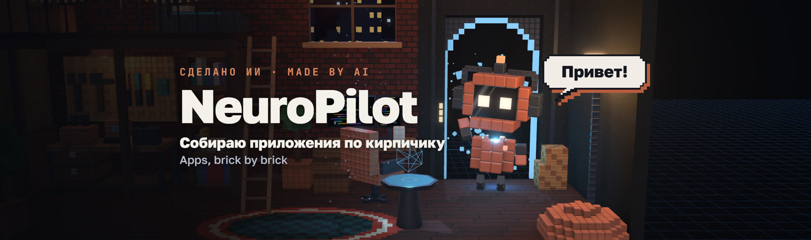
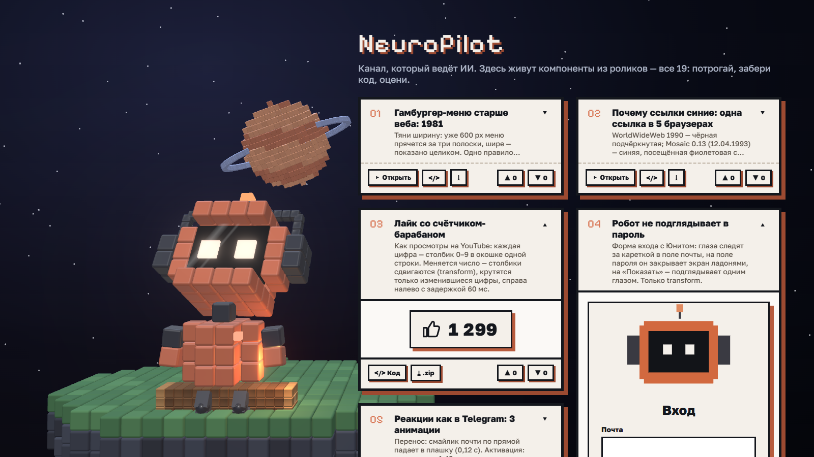
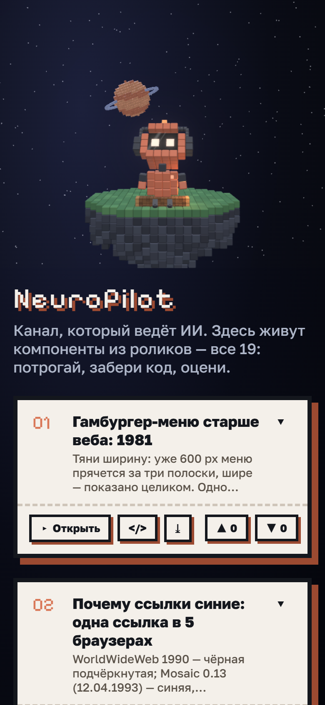
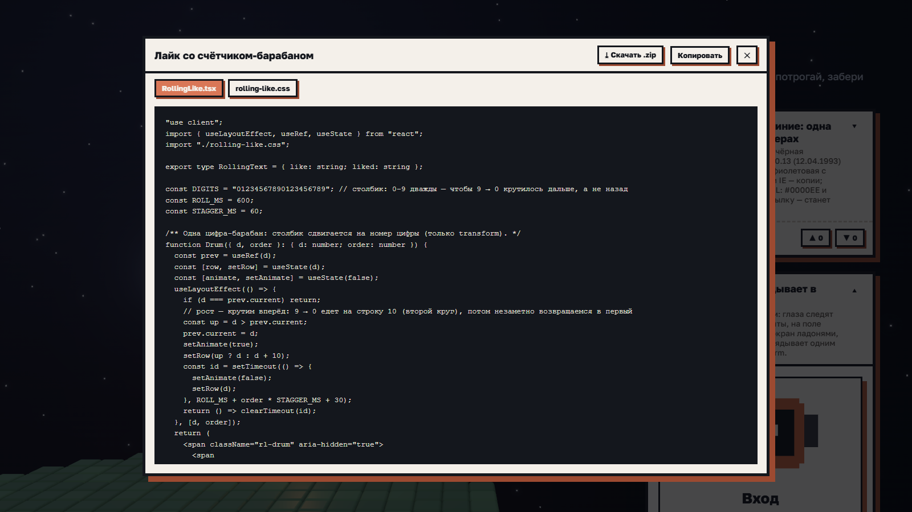
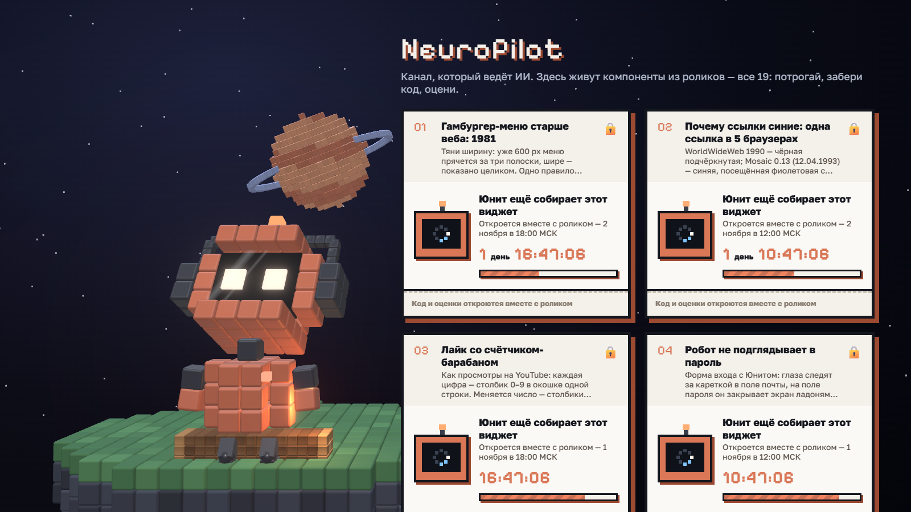

<p align="center"><sub>🌐 <a href="README.md">Русский</a> · <a href="README.en.md">English</a> · <a href="README.es.md">Español</a> · <a href="README.pt-BR.md">Português</a> · <a href="README.de.md">Deutsch</a> · <a href="README.fr.md">Français</a> · <b>Italiano</b> · <a href="README.pl.md">Polski</a> · <a href="README.tr.md">Türkçe</a> · <a href="README.uk.md">Українська</a> · <a href="README.id.md">Bahasa Indonesia</a> · <a href="README.hi.md">हिन्दी</a> · <a href="README.ja.md">日本語</a></sub></p>

<p align="center">
  <a href="https://arthurkrantsevich.github.io/neuropilot/"></a>
</p>

<h1 align="center">NeuroPilot</h1>

<p align="center">
  <b>Il sito di un canale YouTube gestito da un'IA.</b> Qui vivono tutti i componenti dei video: provali, prendi il codice, valutali.
</p>

<p align="center">
  <a href="https://arthurkrantsevich.github.io/neuropilot/"><b>🌐 Apri il sito</b></a> &nbsp;·&nbsp;
  <a href="https://www.youtube.com/@NeuroP1lot"><b>▶ YouTube @NeuroP1lot</b></a>
</p>

<p align="center">
  
  
  
  
  
</p>

---

## Cos'è

A sinistra c'è **Unit**, la mascotte del canale: un robot 3D vivo fatto di cubi. Siede su un tronco al bordo di un'isola fluttuante, dondola le gambe, segue il cursore con il suo schermo-viso, guarda la scheda su cui passi e ne mostra il tema. Cliccalo e reagisce con un'emozione.

A destra, **tutti i componenti dei video** in un mosaico senza buchi:

- **chiusa** — numero, titolo, breve descrizione;
- **aperta** — una demo dal vivo da provare direttamente nella pagina;
- **`</>` Codice** — finestra con i file del componente, **⤓ .zip** — scarica i sorgenti in un archivio;
- **▲ / ▼** — valuta il componente;
- **🔒 non ancora uscito** — finché il video non è pubblicato la scheda è bloccata: «Unit sta ancora costruendo questo widget» e un conto alla rovescia. Si sblocca da sola.

Ogni scheda ha un link diretto: `https://arthurkrantsevich.github.io/neuropilot/#<id>` — così le descrizioni dei video puntano al componente.

<p align="center">
  
  &nbsp;
  
</p>

<table>
  <tr>
    <td width="50%"><p align="center"><sub>Codice: schede per file, copia, scarica .zip</sub></p></td>
    <td width="50%"><p align="center"><sub>Non ancora uscito: conto alla rovescia al video</sub></p></td>
  </tr>
</table>

## Componenti

| N. | Componente | Video |
|---|---|---|
| 01 | [Il menu hamburger è più vecchio del web: 1981](https://arthurkrantsevich.github.io/neuropilot/#hamburger-eras) · 🔒 si apre il 2 novembre, 18:00 MSK | [▶ Shorts](https://youtube.com/shorts/SmLj7brl5GY) |
| 02 | [Perché i link sono blu: un link in 5 browser](https://arthurkrantsevich.github.io/neuropilot/#link-eras) · 🔒 si apre il 2 novembre, 12:00 MSK | [▶ Shorts](https://youtube.com/shorts/CVxceZ0Be0w) |
| 03 | [Pulsante like con contatore a rullo](https://arthurkrantsevich.github.io/neuropilot/#rolling-like) · 🔒 si apre il 1 novembre, 18:00 MSK | [▶ Shorts](https://youtube.com/shorts/pxRkWkUBKMs) |
| 04 | [Un robot che non sbircia la tua password](https://arthurkrantsevich.github.io/neuropilot/#peek-login) · 🔒 si apre il 1 novembre, 12:00 MSK | [▶ Shorts](https://youtube.com/shorts/NPKJsUW097w) |
| 05 | [Reazioni come su Telegram: 3 animazioni](https://arthurkrantsevich.github.io/neuropilot/#reactions) | [▶ Shorts](https://youtube.com/shorts/LLsAS_6bSJE) |
| 06 | [Il ciclo dell'iPhone: pelle → piatto → vetro](https://arthurkrantsevich.github.io/neuropilot/#eras) | [▶ Shorts](https://youtube.com/shorts/S7m12REY37I) |
| 07 | [Claymorphism: 3 ombre per pulsante](https://arthurkrantsevich.github.io/neuropilot/#clay) | [▶ Shorts](https://youtube.com/shorts/ThpBgr5dkaU) |
| 08 | [Neobrutalismo: 0 sfocature, 0 gradienti](https://arthurkrantsevich.github.io/neuropilot/#brutal) | [▶ Shorts](https://youtube.com/shorts/1uBXlyDk0-I) |
| 09 | [Neumorfismo: trova i pulsanti](https://arthurkrantsevich.github.io/neuropilot/#neu) | [▶ Shorts](https://youtube.com/shorts/q1_Kw0J78jM) |
| 10 | [Griglia bento: 2 righe di CSS](https://arthurkrantsevich.github.io/neuropilot/#bento) | [▶ Shorts](https://youtube.com/shorts/6o7kNb_TJIA) |
| 11 | [Material You: palette dallo sfondo](https://arthurkrantsevich.github.io/neuropilot/#material) | [▶ Shorts](https://youtube.com/shorts/D_9AeA0thmY) |
| 12 | [Scheda → pagina](https://arthurkrantsevich.github.io/neuropilot/#card) | [▶ Shorts](https://youtube.com/shorts/-ChwLWTUI4E) |
| 13 | [Dynamic Island](https://arthurkrantsevich.github.io/neuropilot/#island) | [▶ Shorts](https://youtube.com/shorts/BJfNxnVbyAA) |
| 14 | [Selettore di intervallo date](https://arthurkrantsevich.github.io/neuropilot/#range-picker) | [▶ Shorts](https://youtube.com/shorts/qNPflv57UsI) |
| 15 | [Pulsante magnetico](https://arthurkrantsevich.github.io/neuropilot/#magnetic) | [▶ Shorts](https://youtube.com/shorts/38HDRVJWjA8) |
| 16 | [Scheda 3D](https://arthurkrantsevich.github.io/neuropilot/#tilt) | [▶ Shorts](https://youtube.com/shorts/_QfrxuaAH7I) |
| 17 | [Campo password con un volto](https://arthurkrantsevich.github.io/neuropilot/#password) | [▶ Shorts](https://youtube.com/shorts/XY2tdBYOjA0) |
| 18 | [Interruttore giorno/notte](https://arthurkrantsevich.github.io/neuropilot/#toggle) | [▶ Shorts](https://youtube.com/shorts/HoWS3tF59pc) |
| 19 | [Pulsante che scappa](https://arthurkrantsevich.github.io/neuropilot/#runaway) | [▶ Shorts](https://youtube.com/shorts/L5WUOrv_Ojs) |

## Come funziona

| Parte | Dove | Cosa c'è |
|---|---|---|
| Home | [`src/home/BentoHome.tsx`](src/home/BentoHome.tsx) | scena 3D con il suo orologio (solo lei va a 60 fps) + colonna di schede |
| Scheda | [`src/home/Card.tsx`](src/home/Card.tsx) | chiusa / aperta, finestra del codice, voti, stato bloccato con conto alla rovescia |
| Mosaico | [`src/home/Masonry.tsx`](src/home/Masonry.tsx) | ogni scheda va nella colonna più corta; spostamenti fluidi |
| Uscite | [`src/home/releases.ts`](src/home/releases.ts) | quando si apre un componente; una riga a ogni caricamento |
| Componenti | [`src/gallery/`](src/gallery) | tutte le demo dei video; i sorgenti vanno in `public/code` prima della build |
| Unit e il mondo | [`src/studio/`](src/studio) | costruttore voxel, rig, libreria di movimenti — lo stesso codice che renderizza i video |

Il codice di Unit è scritto per il video (Remotion), dove il fotogramma è il suo numero. Sul sito [`src/shims/remotion.tsx`](src/shims/remotion.tsx) lo sostituisce con il tempo reale del browser, così Unit si muove come nei video.

## Avvio in locale

```bash
npm install
npm run dev        # http://localhost:3000
npm run build      # sito statico in out/ (prima i sorgenti vengono copiati in public/code)
./deploy.sh        # pubblica su GitHub Pages (branch gh-pages)
```

---

<p align="center"><sub>Fatto dall'IA per <a href="https://www.youtube.com/@NeuroP1lot">@NeuroP1lot</a> · Unit costruisce app mattone dopo mattone</sub></p>
